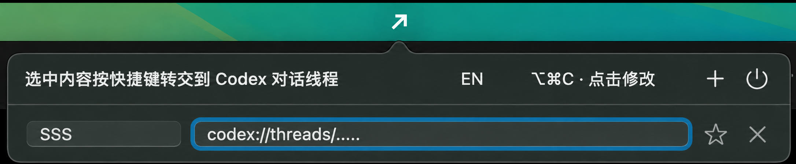
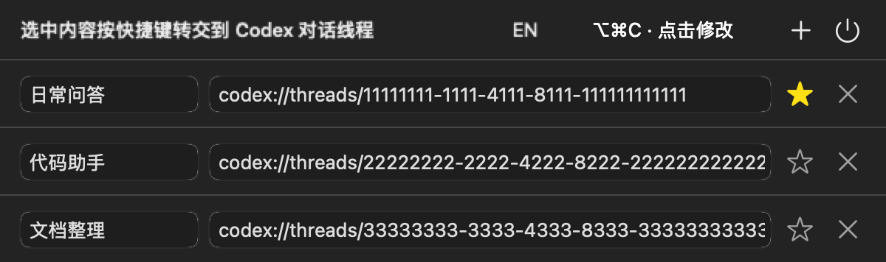
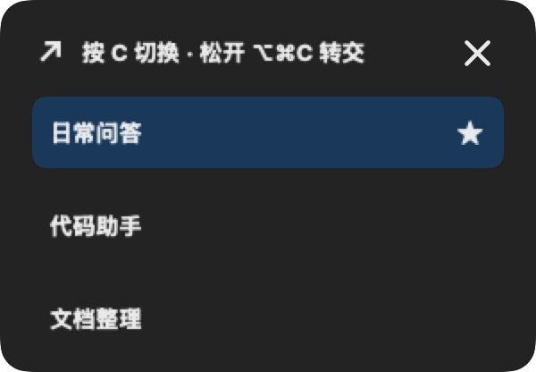
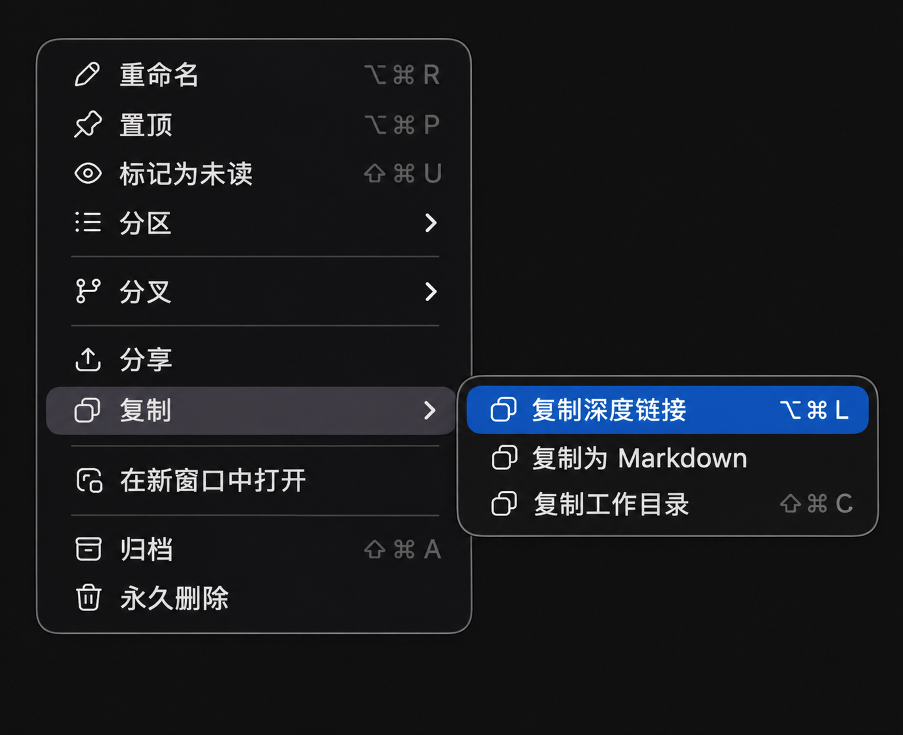

# Quick to Codex（Q2C）

**选中内容，快捷键直达 Codex**

Q2C 是一款轻量的 macOS 菜单栏工具。选中来源应用中的文字、图片等可复制内容，按下快捷键，选择目标 Codex 对话，即可原样粘贴，由你手动发送。

**省去手动复制、切换窗口、粘贴的来回操作，一个快捷键串起整个流程。**

- **小巧轻量**：整包不到 2 MB，常驻菜单栏，随时调用。
- **干净清爽**：界面简洁，没有广告。
- **本地运行**：不读取、不保存、不筛选或改写剪贴板内容，仅观察剪贴板版本变化。
- **快捷顺手**：支持自定义快捷键，让内容转交更省心。
- **灵活配置**：支持中英文界面，最多 8 组目标配置，可添加备注、标星设置默认目标。

## 界面预览

菜单栏设置浮窗：



设置面板：



目标选择弹窗：



## 下载与安装

从 [GitHub Releases](https://github.com/yuebozhang/Q2C/releases) 下载预览安装包，解压后将 `Q2C.app` 拖到“应用程序”目录，再打开。应用运行后显示在菜单栏，不显示 Dock 图标。

当前下载包面向 **Apple Silicon、macOS 14 或更新版本**。需要已安装并登录 Codex 桌面应用。源码要求 Swift 6 和可用的 Xcode / Command Line Tools，没有第三方 Swift 包依赖。

当前预览包使用开发用自签名证书，**尚未通过 Apple 公证**。首次打开可能需要在“系统设置 → 隐私与安全性”中允许打开。如果组织策略不允许，请使用源码自行构建；无需关闭系统安全保护。

在“系统设置 → 隐私与安全性 → 辅助功能”中为 Q2C 授权，以便发送复制和粘贴事件。应用不会替你更改权限。

## 快速使用

1. 在 Codex 中打开目标对话，从该对话菜单选择“复制 → 复制深度链接”。Q2C 接受 `codex://threads/<任务UUID>` 格式。

   

2. 点击菜单栏 Q2C 图标，在链接框填写目标链接；左侧备注可选，仅用于区分配置，不参与转交。
3. 右上角 `+` 添加配置；最多 8 组，有空链接时先填写再新增。每行 `×` 删除配置，删除前会确认。
4. 点击星号设为默认目标；再次点击可取消。标星目标在选择弹窗置顶，其余保持设置顺序。
5. 使用鼠标键盘等选中屏幕中的内容，按默认快捷键 ⌥⌘C触发转发弹窗,选择对应目标配置即可完成转发.

顶部 EN/CN 切换语言，点击快捷键文字可录制新组合，电源图标退出应用。快捷键可自定义。设置框支持 ⌘A/C/X/V，⌘W 关闭设置，⌘Q 退出。

线程链接示例（合成 ID，仅展示格式）：

```text
codex://threads/.....
```

## 隐私与本机数据

- 当前转交流程不读取剪贴板正文、类型或文件路径，不保存转发历史，不读取 Codex 对话、消息或草稿。
- 当前流程不发起网络请求，无遥测、统计或配置云同步；来源应用负责复制，Codex 接收系统原生粘贴。你在 Codex 发送后的数据处理遵循 Codex 自身规则。
- 来源复制的内容仍可能留在系统剪贴板，退出 Q2C 不会清空它。
- 配置位于 `~/Library/Application Support/Q2C/config.local.json`，保存目标链接、备注、快捷键和标星；旧头尾字段仅兼容保留、不使用。
- 日志位于 `~/Library/Logs/Q2C/`，只记录流程阶段、耗时、PID、版本号和失败原因，不记录载荷、文件名、文件路径或任务链接。单文件达到 1MiB 后轮换，保留当前和上一份。
- 配置和日志目录权限为 `0700`，文件为 `0600`；本机配置、日志和构建产物不提交到仓库。

## 从源码构建

```sh
git clone https://github.com/yuebozhang/Q2C.git
cd Q2C
swift test
zsh scripts/build-app.sh
```

产物为 `dist/Q2C.app`。脚本优先使用本机 `Q2C Local Dev` 签名身份，没有时使用 ad-hoc；也可通过 `Q2C_CODESIGN_IDENTITY` 指定已有身份。构建不会安装、启动应用、修改权限或注册快捷键。

## 项目资料

- [使用流程](docs/usage-flow.md)
- [实现说明](docs/implementation.md)
- [实施路线](docs/roadmap.md)
- [开发约定](AGENTS.md)

这是独立开发的工具，并非 OpenAI 官方应用。

## 许可证

源码和项目自绘图标使用 [Apache License 2.0](LICENSE)，版权说明见 [NOTICE](NOTICE)。
